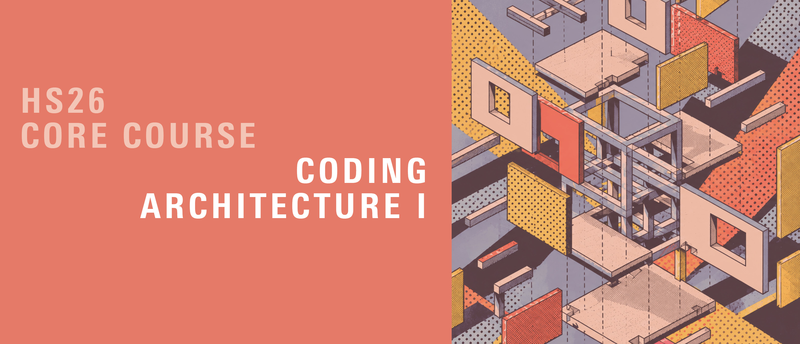
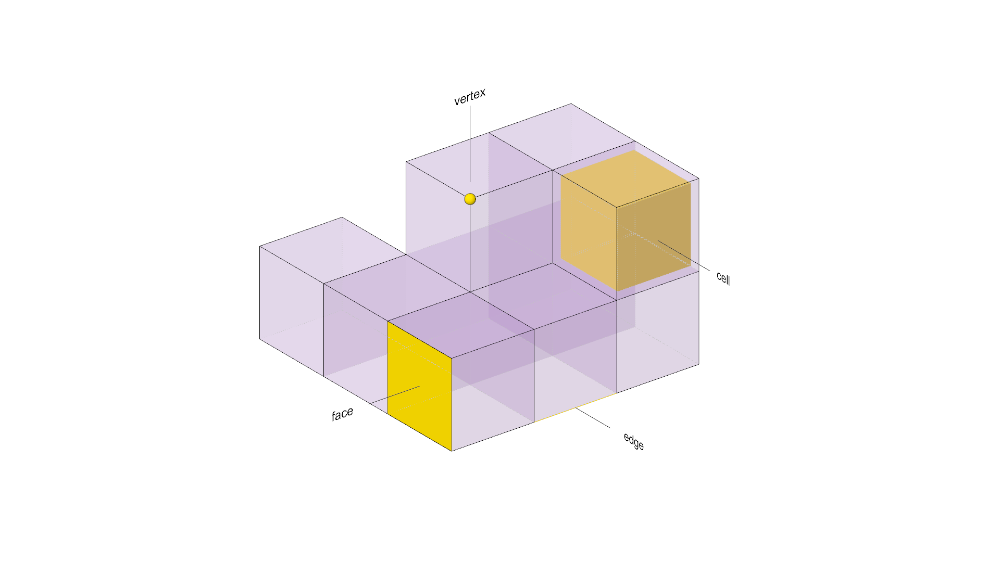
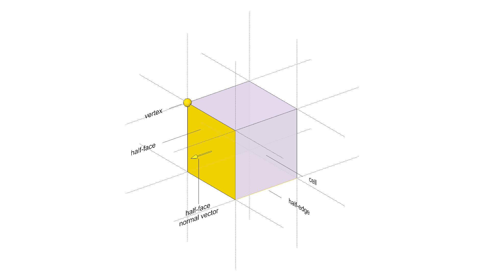
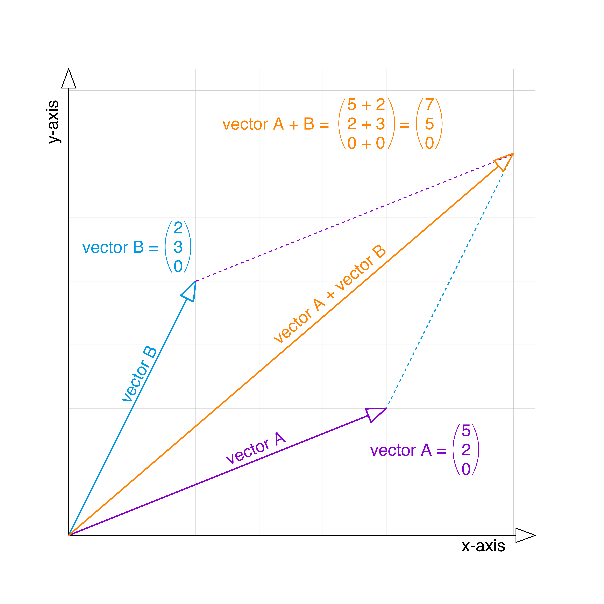
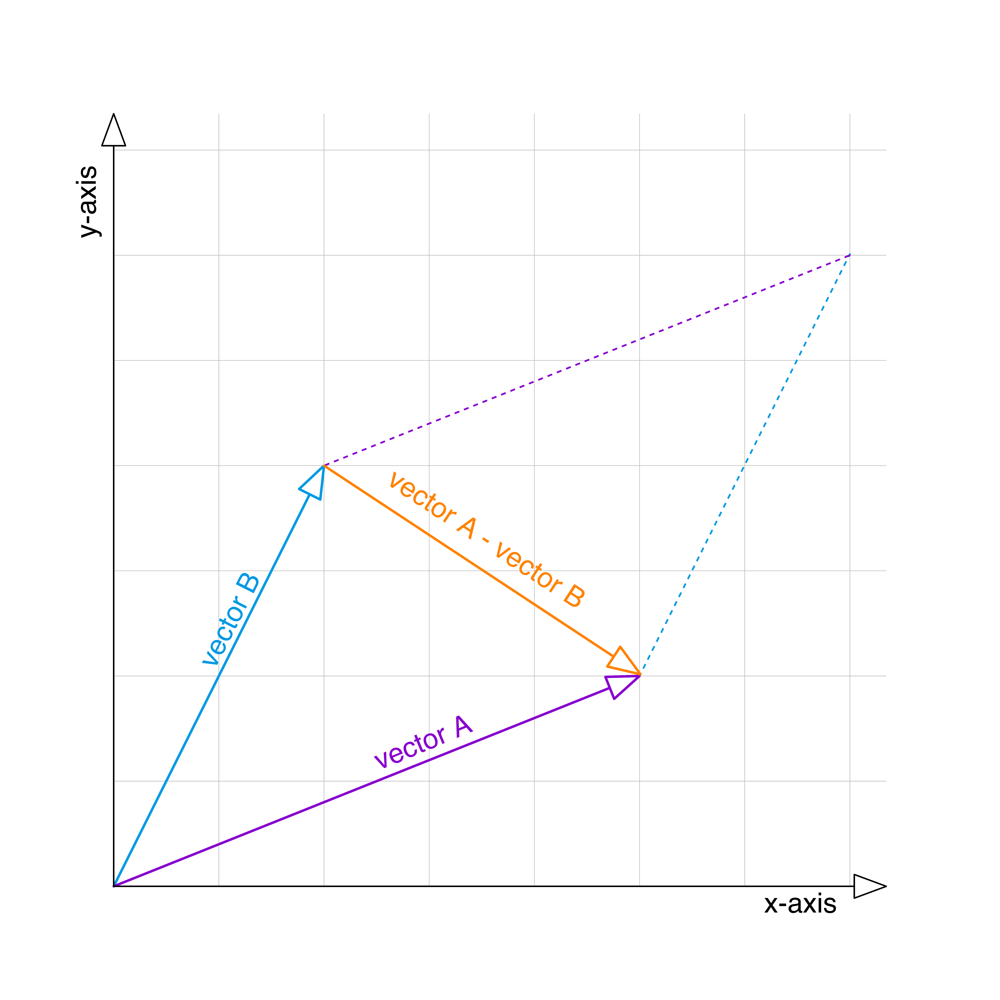
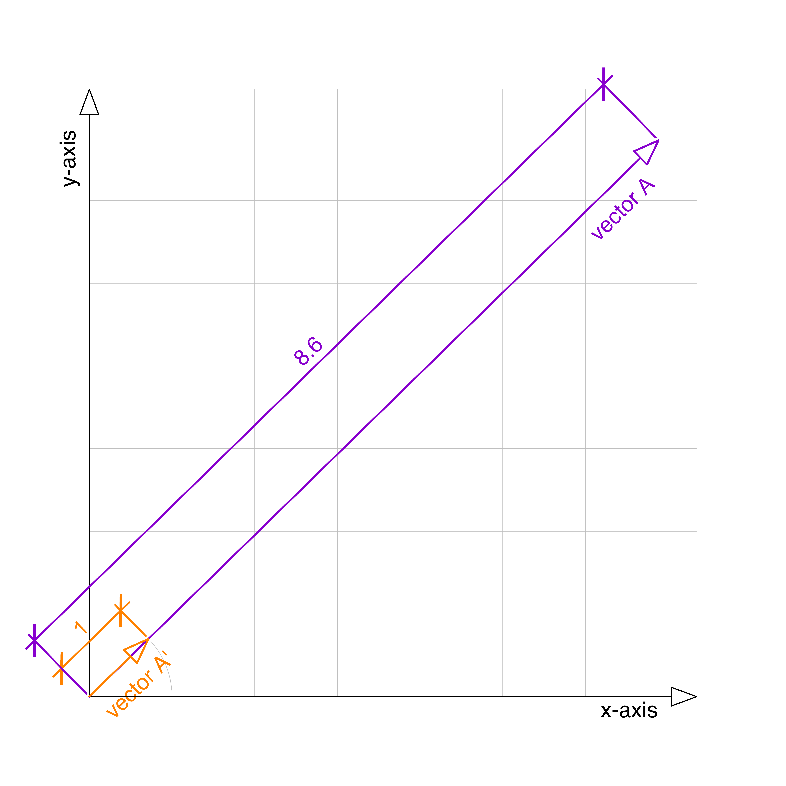
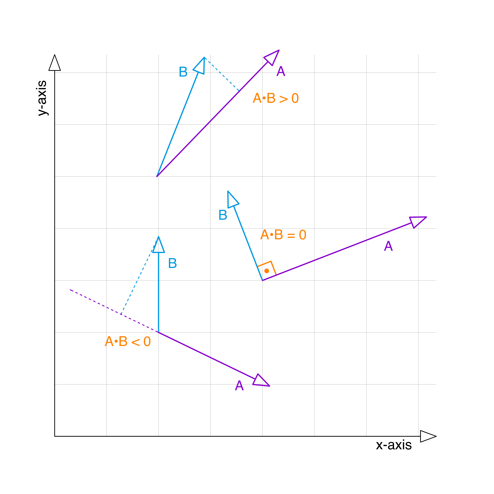
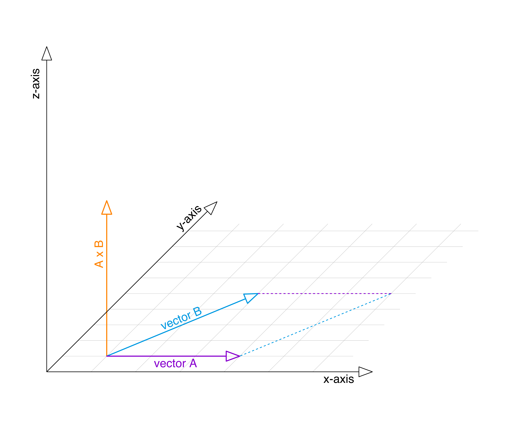

# Coding Architecture I: HS26

## Week 07 - Data structures



## Table of Contents

* [Overview](#overview)
* [Slides](#slides)
* [Content](#content)
    + [Recap](#recap)
    + [Principles of OOP](#principles-of-oop)
    + [Data structures](#data-structures)
        - [**Graph**](#graph)
        - [**Mesh**](#mesh)
        - [**VolMesh**](#volmesh)
    + [Vector arithmetic and friends](#vector-arithmetic-and-friends)
    + [Building grid exercise](#building-grid-exercise)
* [Code Examples](#code-examples)

## Overview

This week we will recap object-oriented programming and use it to organize geometry and its connections. We will compare three COMPAS data structures: `Graph`, `Mesh` and `VolMesh`, then focus on `VolMesh` for our building grid.

We will rebuild the filtered box grid from previous lectures as connected cells. This lets us ask questions about neighbours and boundaries, and generate columns and beams from the grid's edges.

By the end of the lecture, you should be able to:

- Distinguish geometry (positions and shapes) from topology (how elements connect).
- Explain why adjacent VolMesh cells must share vertex keys and have consistently oriented faces.
- Use a class to bundle the grid with its columns, beams and generation methods.
- Use unit vectors and dot products to select vertical and horizontal edges.

Use the [HS26 building-grid conventions](./building-grid-conventions.md) for vertex order and outward face winding. The later slab and façade lessons use the same conventions. There is no new assignment this week; the building grid is an in-class exercise.


## Slides

[](https://docs.google.com/presentation/d/1kx2HicWXMusfwXZa5TgV102RMFnw-OnAwL6kEYQwdEg/edit?usp=drive_link)

<div style="display: flex; justify-content: center; align-items: center; height: 1vh;">
    <p style="font-size: 75%;">
        ↑ click to open ↑
    </p>
</div>

## Content


### Recap

We have seen how to define single data values, list (and other collections) of data values, how to define geometry data types, and how to define behavior (algorithms) encapsulated into functions.

Object-oriented programming allows us to create new data types that combine the data and the behavior into one bundle. They encapsulate everything that belongs together inside of them. They act as blueprints that we can use to create new instances (objects) of the same type.

```python
# ---------------------------------------------
# --- defining data: single/multiple values ---


a = 42                    # integer
b = 3.14                  # float
c = True                  # bool
d = "Hello"               # string

values = [1, 2, 3, 4, 5]  # explicit list
values = range(6)         # range sequence (use list(range(6)) for a list)
```

```python
# ---------------------------------------------
# ------ defining data: geometric types -------
# -------------- using COMPAS  ----------------

from compas.geometry import Point
from compas.geometry import Box

point = Point(1, 0, 0)
box = Box(2.0, 1.0, 0.6)
```


```python
# ---------------------------------------------
# ------ defining behavior: functions ---------


def is_even(number):
    if number % 2 == 0:
        return True
    else:
        return False


print(is_even(2))
print(is_even(3))
```

```python
# ---------------------------------------------
# ---- defining data + behavior: new types ----


class Room:
    def __init__(self, name, height, color):
        self.name = name
        self.height = height
        self.color = color

    def paint(self, new_color):
        self.color = new_color
```

### Principles of OOP

There are four principles of object-oriented programming:

1. **Abstraction: Hiding Details**

   Abstraction is like the blueprints you would create for a building. You only show the main parts needed to understand (e.g. rooms, walls, and doors), but normally you don't add every tiny detail, like nails or screws.

   In programming, **abstraction** means exposing the operations people need without requiring them to understand the implementation. For example, `volmesh.cell_neighbors(cell)` lets us ask for neighbours without implementing the topology lookup ourselves. A leading underscore marks an implementation detail by convention in Python; it does not prevent access.

2. **Encapsulation: Keeping Things Together**

   When we design a room, we decide where the walls go and what will be inside the room. We keep everything about that room (its furniture, doors, windows) inside that room. This is encapsulation: keeping things that belong together in one place and not letting random stuff from other rooms wander in.

   In programming, encapsulation is about keeping data and behavior (e.g. functions) together in one place, so things don’t get mixed up. This helps keep everything organized.

3. **Inheritance: Passing Down Features**

   Once we designed a room, we might realize we also need other types of rooms, but they share a lot of similarities to our first room design and only add a few extra features.

   Inheritance in programming lets us create a blueprint of a data type for a generic room, and then make new room blueprints that are based on our original one. They inherit the basics but allow us to add extras when needed. This way, we don’t have to start over each time.

4. **Polymorphism: Acting Differently according to the Situation**

   Imagine that each room has a light switch, but some rooms need different types of lighting.

   Polymorphism means that even though every room has a light switch, each room can make that switch work a bit differently depending on what kind of room it is. We already use this with filters: `LinearFilter`, `RandomFilter` and `ModuleBasedFilter` all provide `is_included(point, ix, iy, iz)`. The grid uses the same call for each filter, while each object decides differently which cells to include. They do not need to inherit from a common class to support that interface in Python.

### Data structures

Data structures organize data and provide operations for working with it. A Python list, for example, groups items in a sequence and supports appending, removing, slicing and indexing.

In COMPAS, data structures are implemented as classes. They store connections between geometric elements as well as attributes such as coordinates, colours or categories. This connectivity is called **topology**. Two boxes can touch geometrically without having any stored connection to each other.

We will compare three COMPAS data structures:

#### **Graph**

A graph stores nodes and edges describing relationships between them. For example, rooms can be nodes and door connections can be edges.

The implementation in COMPAS also allows adding custom attributes at the graph, node and edge level, as well as translating to and from `NetworkX` (another popular graph library for Python).

#### **Mesh**

A COMPAS mesh represents an open or closed polygonal surface using vertices, edges and faces. It is CAD-agnostic, so you can process it outside Rhino. Its half-edge data structure records face connectivity and supports n-sided polygonal faces.

Just like the graph, this data structure allows adding custom attributes at the mesh, vertex, edge and face levels.

#### **VolMesh**

This data structure represents a volumetric mesh made of polyhedral cells. A polyhedron is a three-dimensional shape with flat polygonal faces and straight edges.




Similarly to the mesh, the `VolMesh` is CAD agnostic, it's based on the concept of half-face data structures, and it allows adding custom attributes at the volmesh, vertex, edge, face and cell levels.

VolMeshes do not have to be orthogonal, but we will use an orthogonal one for our following exercises for the sake of simplicity.

Once we have built the topology, we can query a cell's neighbours, identify boundary faces and generate structural elements from unique edges. A list of independent boxes would require us to work out these connections ourselves.

For those topological queries to work, adjacent cells must reuse the same
VolMesh vertices. We identify coincident corner points with
`TOL.geometric_key` and add each unique vertex only once. The order of the
vertices in every face is also significant: its winding determines the face
normal. In the building-grid examples, the face lists are ordered so boundary
normals consistently point outwards.

An internal face has two **half-faces**, one owned by each adjacent cell, with opposite outward normals. `volmesh.halffaces()` visits both sides; `volmesh.faces()` returns one representative per face. This distinction will matter when generating one slab per face next week.

Try this standalone example in Python with COMPAS installed. `dx`, `dy` and `dz` are the total grid dimensions; `nx`, `ny` and `nz` are the numbers of cells along each axis.

```python
from compas.datastructures import VolMesh

volmesh = VolMesh.from_meshgrid(dx=8, dy=5, dz=3, nx=2, ny=1, nz=1)
print(volmesh.number_of_cells())
# Output: 2
print(volmesh.number_of_vertices())
# Output: 12 (the two cells share four vertices)
print(len(list(volmesh.faces())))
# Output: 11
print(len(list(volmesh.halffaces())))
# Output: 12

cell = next(volmesh.cells())
neighbours = sorted(set(volmesh.cell_neighbors(cell)))
print(len(neighbours))
# Output: 1
```

The `set` removes repeated neighbour keys that COMPAS 2.15.1 can return. Before running the code, predict how many vertices two independent boxes would store. Then sketch the two normals on the shared face.

### Vector arithmetic and friends

The COMPAS framework allows us to perform many different operations with its geometric types. It's useful to brush up on some of these concepts.

In COMPAS, adding two points produces a new point by adding their coordinates. Subtracting two points produces a vector: `p2 - p1` points from `p1` to `p2`.

```python
from compas.geometry import Point

p1 = Point(1, 0, 0)
p2 = Point(3, 0, 0)

# Add points
print(p2 + p1)
# Output: Point(x=4.000, y=0.000, z=0.000)

# Subtract points
print(p2 - p1)
# Output: Vector(x=2.000, y=0.000, z=0.000)
```

Vectors can be added, subtracted and scaled. Unitizing a nonzero vector gives it length 1 while preserving its direction. The zero vector has no direction and cannot be unitized.

```python
from compas.geometry import Vector

u = Vector(1, 0, 0)
v = Vector(0, 1, 0)

# Add two vectors
print(u + v)
# Output: Vector(x=1.000, y=1.000, z=0.000)
```



```python
from compas.geometry import Vector

u = Vector(1, 0, 0)
v = Vector(0, 1, 0)

# Subtract two vectors
print(u - v)
# Output: Vector(x=1.000, y=-1.000, z=0.000)
```


```python
from compas.geometry import Vector

u = Vector(1, 0, 0)

# Unitize vector
print((u * 2).unitized())
# Output: Vector(x=1.000, y=0.000, z=0.000)
```


There are two very useful operations on vectors that we will need a lot: dot product and cross product.

```python
from compas.geometry import Vector

u = Vector(1, 0, 0)
v = Vector(0, 1, 0)

# Dot product of unit vectors: 0=perpendicular, 1=same direction, -1=opposite
print(u.dot(v))
# Output: 0.0

# Cross product (perpendicular vector) 
print(u.cross(v))
# Output: Vector(x=0.000, y=0.000, z=1.000)
```

1. The **dot product** is `u.length * v.length * cos(angle)`. For two nonzero vectors, `0` means they are perpendicular. For **unit vectors**, `1` means the same direction and `-1` means opposite directions. Unitize vectors before using these tests, and use a tolerance when comparing calculated values.



2. The **cross product** is perpendicular to both input vectors when they are not parallel. Parallel vectors produce the zero vector, which has no direction.



### Building grid exercise

Start with the [building grid tutorial](./examples/02-building-grid-tutorial_hs26_starter.gh) in Rhino 8 / Grasshopper, using the `ca-hs26` Python environment with COMPAS installed. The `class ...` and `grid = ...` placeholders are intentional: the starter will not produce a complete structure until you fill them in.

1. Define `BuildingGrid` and its constructor. Accept `xsize`, `ysize`, `zsize`, `nx`, `ny`, `nz` and `selected_filter`; call the supplied `self.create_volmesh(selected_filter, xsize, ysize, zsize, nx, ny, nz)` and initialize `self.columns` and `self.main_beams` to empty lists. Instantiate the class using the matching Grasshopper inputs.
2. Implement `generate_columns(column_width_x, column_depth_y)`. Store both dimensions on `self`: the supplied beam method uses them to shorten beams to fit between columns. Reset the column list on every call, then visit `self.volmesh.edges()` and select vertical edges by their unit direction's dot product with Z. For each selected edge, create a box with the given X/Y sizes and the edge length as its Z size, centred at the edge midpoint.
3. Call `generate_columns(...)` before the supplied `generate_main_beams(main_beam_width, main_beam_height)`. The beam method selects horizontal edges and places each beam below its edge level.

Use positive dimensions in consistent model units. Keep column widths smaller than their corresponding cell spans so beam lengths remain positive. The exact dot-product tests in the supplied code assume an axis-aligned grid; use a tolerance for more general geometry.

For a deterministic check, temporarily use a filter whose `is_included(point, ix, iy, iz)` always returns `True`. A complete 2 × 2 × 2 grid should have **8 cells, 27 shared vertices, 18 columns and 36 main beams**. Columns are counted per vertical edge, so a two-storey column line contains two column segments. Running either generation method again should leave its element count unchanged. An empty selection should produce empty element lists.

**Optional:** add `number_of_columns()` and `number_of_main_beams()` methods that return the lengths of their lists. Implement `calculate_volume()` as the sum of the generated boxes' volumes. This is a sum of member volumes; it does not remove overlaps or perform a structural assessment. The worked solution includes these extensions.

After trying the exercise, compare with the linked solution. It completes the same starter canvas and uses the same constructor:

```python
# Call-site example: these values come from the Grasshopper inputs.
grid = BuildingGrid(xsize, ysize, zsize, nx, ny, nz, selected_filter)
grid.generate_columns(column_width_x, column_depth_y)
grid.generate_main_beams(main_beam_width, main_beam_height)
```

The filter tests each candidate cell's lower corner at `(ix * xsize, iy * ysize, iz * zsize)`. It does not test every corner or guarantee that the entire cell lies inside a Brep. `create_volmesh` returns the connected cells; the `Box` objects used to obtain corner coordinates are temporary construction helpers.

Next week, Assignment 03 keeps this constructor and adds element classes carrying `geometry` plus the relevant edge or half-face key. A week-07 column is a `Box`; an A03 column is a `Column` whose box is `column.geometry`. Use `.geometry` when adapting your optional metrics for Assignment 03. This building grid provides the foundation for adding slabs and façades in the upcoming assignments and final project.

## Code Examples

These are the three current examples. There is one building-grid starter and one completed solution:

- [Geometry and data structures](./examples/01-geometry-and-datastructures_hs26.gh): eight guided experiments, including an angle slider, a Swiss-city shortest-path graph, a canopy mesh and a coloured VolMesh neighbour explorer.
- [Building grid tutorial](./examples/02-building-grid-tutorial_hs26_starter.gh): start here for the class exercise.
- [Building grid tutorial: solution](./examples/02-building-grid-tutorial_hs26_solution.gh): the completed starter, including optional count and volume methods. Use this as the week-07 reference.

In example 01, the canopy has a `curvature` input, initially **0.08**; set it to **0** to flatten the mesh or use a negative value to reverse its curvature. Try the angle slider at **0°, 90° and 180°**, then compare raw and unit-vector dot products. In the VolMesh explorer, try cell keys **0, 1, 4 and 13** and predict **3, 4, 5 and 6 neighbours**. Orange marks the selected cell; translucent teal marks its face-neighbours. The live panel reports cell, vertex, face and half-face counts. Cells are previewed at their full original size.

The preview helpers place drawn copies in separate gallery stations, leaving the COMPAS data in its original coordinates. Use Rhino's Zoom Extents to see the whole gallery, and zoom the Grasshopper canvas into a coloured group to read its prompt. Selecting preview objects temporarily highlights them in Grasshopper's selection colour; deselect to see the orange/teal colours again.

The graph experiment uses ten geographically positioned Swiss cities, a simplified country outline, city labels and fifteen connections. It calls `graph.shortest_path(start, destination)` to find the route with the shortest total geometric edge length, shown in blue. Select the start and destination by city name using the two dropdowns and inspect the result. Weighted routing with `dijkstra_path` is mentioned only as an optional extension. See the [city positions and outline sources](./swiss-city-map.md).

---

<p align="middle">

</p>
