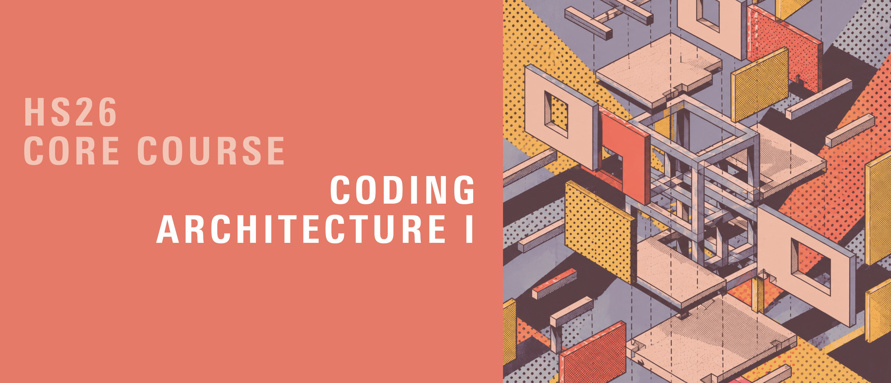
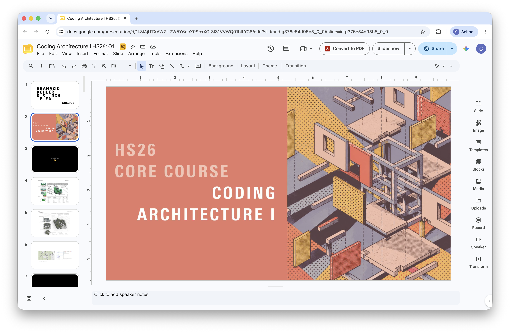
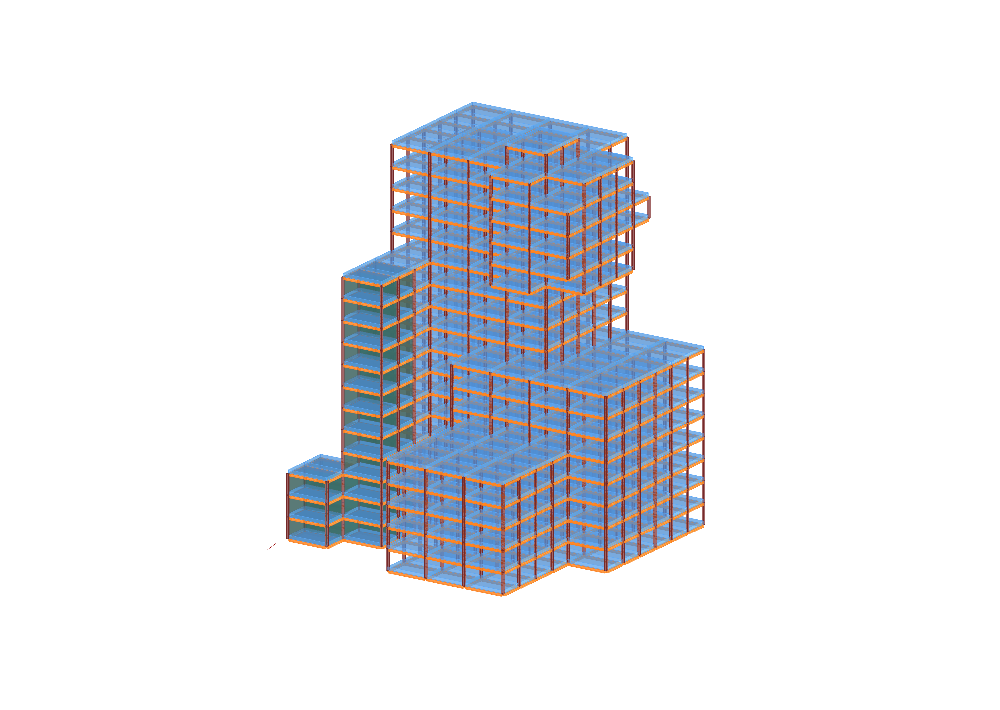
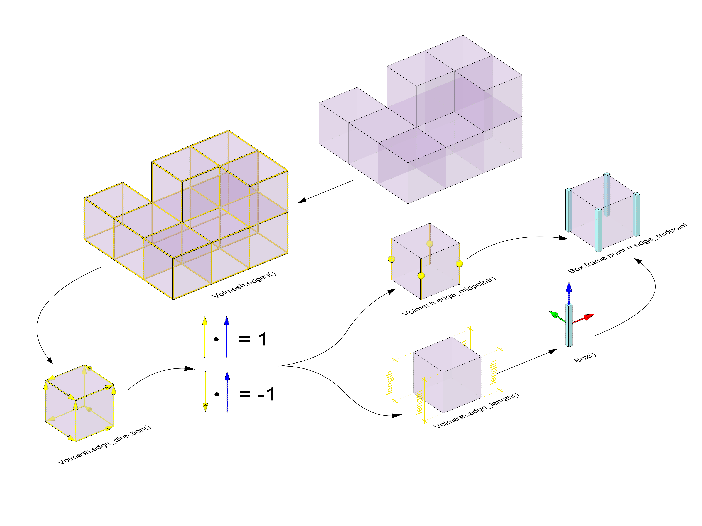
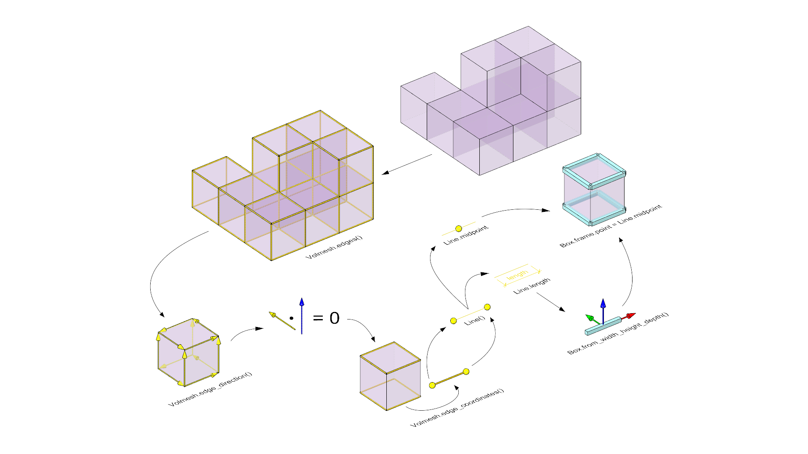
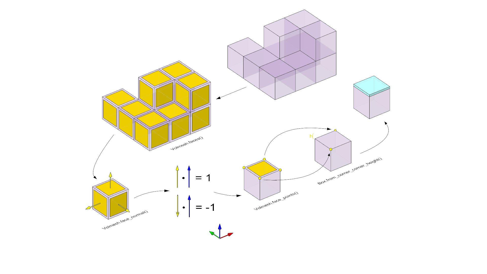

# Coding Architecture I: HS26

Use the [HS26 building-grid conventions](../week-07/building-grid-conventions.md) for face winding, shared vertices, and slab classification.

## Week 08 - Building Grid



## Table of Contents

* [Overview](#overview)
* [Slides](#slides)
* [A02 Review](#a02-review)
* [Personalized Quiz](#personalized-quiz)
* [A03 Handout](#assignment-03)
* [Micro Exercises](#micro-exercises)

## Overview

The focus of this week is to continue building our architectural grid by introducing slabs. We’ll deepen our understanding of object-oriented programming by applying it to new structures within our building grid, specifically exploring how slabs interact with the columns and beams already in place.

Continue from the [week-07 building-grid solution](../week-07/examples/02-building-grid-tutorial_hs26_solution.gh) using the supplied A03 starter. Its constructor and shared topology are unchanged. The A03 file wraps geometry (boxes) in `Column`, `MainBeam` and `Slab` objects so each can also remember its source edge or half-face; access their geometry through `.geometry`.

We will not introduce any new programming concepts today. Instead, we’ll concentrate on reinforcing previous skills through discussion, practical review, and assessment:

* A detailed review of Assignment 02 (A02), covering both the main task and challenges, and how these build foundational skills in structuring and filtering data.
* A personalized quiz about the code you submitted for A02.
* An introduction to Assignment 03 (A03), focusing on using classes to generate slabs within the building grid.


## Slides

[](https://docs.google.com/presentation/d/1SN7lUpMSk4hrWwitFH757mslqmenEVB-YxL_qjOdSpw/edit?usp=drive_link)

<div style="display: flex; justify-content: center; align-items: center; height: 1vh;">
    <p style="font-size: 75%;">
        ↑ click to open ↑
    </p>
</div>

## A02 Review

We’ll begin with a comprehensive walkthrough of Assignment 02. This review will cover:

* For the main task we’ll break down how the brep filter class was meant to be setup.
* For challenge 01 we’ll review both steps: remapping numbers to a target range and using them with the RGB component in Grasshopper to create individual colors.
* For challenge 02 we'll see how to setup a merge filter class, that calls two other filters and combines them according to two modes: union and intersection.

## Personalized Quiz

After the review, you will take a short quiz personalized to your own A02 submission: 6 questions in 20 minutes, asking you to explain and reason about the code you wrote. The quiz is graded and counts for 40% of your A02 grade.

## Assignment 03



### Slab Class

The Assignment of this week will be to **reproduce** the `slab class` we will be programming together in class. This assignment will require implementing a new Slab class, which defines the attributes and behaviors of slabs as they relate to the building structure. The main objectives will be:

* Creating Slabs: Define and categorize slabs within the grid, identifying roofs, floor slabs and bottom slabs.
* Stacking the slabs on a warehouse grid to visualize the amount of material we're using.

Assignment 03 will bring all the elements together, using object-oriented principles to generate a structured, adaptable representation of the building. Click the link [here](../../assignments/A03-building-grid/README.md) to learn the details of assignment 03.

#### Column Generation



#### Beam Generation - Recap




#### Slab Generation - Workflow




## Micro Exercises

The following are simple micro exercises that you can go through to practice some of the concepts of the current lecture and previous lectures. Each of them should not take a long time to complete. They are completely optional.

#### Basic Classes and Methods

1. **Create and Filter a List of Objects:**
    - Define a `Room` Class: Create a class Room with two attributes, `type` and `color`. The type attribute should define the room's purpose (e.g., "kitchen," "bedroom"), and color should define its color (e.g., "blue," "yellow").
    - Create a List of Room Instances: Instantiate multiple Room objects with various types and colors. Store these instances in a list called rooms.
    - Filter and Print Specific Rooms: Write code that iterates over the rooms list and prints out only the rooms of a specific type and color of your choice.

2. **Check if Points are Inside a Box Using a Class:** Define a class `BoxInspector` that takes a `Box` object upon initialization. Add a method `is_point_inside` that takes a Point as input and returns `True` if the point is inside the box, and `False` otherwise. Test this method with several points and a box of your choice to verify if each point lies within the box boundaries.


#### COMPAS Datastructures and Geometry

3. **Simple VolMesh Setup:** Create a function that initializes a `VolMesh` with a single box cell. Add all vertices and faces of the box to the `VolMesh` structure, and print the vertices and faces to confirm they were added correctly.

4. **Create a Diagonal Line Between Two Vertices in VolMesh:** Access two opposite corner vertices of the `VolMesh`'s single box cell, and create a line between them. This exercise helps to practice accessing specific vertices within a cell and performing operations with them.


#### Vector and Geometry Calculations

5. **Dot Product Check for Orientation:** Write a function is_parallel_to_xy that takes a vector as input and returns True if it’s parallel to the XY plane and False otherwise. Test this function with the Z-axis vector and another random vector.

6. **Vector Arithmetic:** Create two Vector instances, v1 and v2, with coordinates of your choice. Calculate and print the dot product and cross product of the two vectors.

7. **Calculate distances between points in a grid:** Create a 5x5 grid of Point instances in the XY plane (Z=0). Write a function calculate_distances that calculates the Euclidean distance from each point to a reference point at [2, 2, 0]. Print the list of distances.

8. **Remap a list of values:** Given a list values = [2, 5, 7, 10], remap each value onto a new range from 0 to 255. Print the resulting list of remapped values.


<details markdown="1">
  <summary><b>Solutions</b></summary>

#### Basic Classes and Methods

1.

```python
# Initial Setup
class Room:
    def __init__(self, room_type, color):
        self.type = room_type
        self.color = color

# List of Instances
rooms = [
    Room("kitchen", "yellow"),
    Room("bedroom", "blue"),
    Room("bathroom", "white"),
    Room("living room", "green"),
    Room("bedroom", "red")
]

# Filter for rooms of a specific type and color
selected_type = "bedroom"
selected_color = "red"

for room in rooms:
    if room.type == selected_type and room.color == selected_color:
        print(f"Found a room of type: {room.type} and color: {room.color}")
```

2.

```python
from compas.geometry import Point, Box

class BoxInspector:
    def __init__(self, box):
        self.box = box

    def is_point_inside(self, point):
        return self.box.contains_point(point)

# Test the BoxInspector class
box = Box.from_width_height_depth(4, 4, 4)
inspector = BoxInspector(box)

pointA = Point(1, 1, 2)
pointB = Point(5, 5, 5)

print("Is Point A inside the Box? Answer:", inspector.is_point_inside(pointA))
print("Is Point B inside the Box? Answer:", inspector.is_point_inside(pointB))
```

#### COMPAS Datastructures and Geometry

3.

```python
from compas.datastructures import VolMesh
from compas.geometry import Point, Box, Line


def create_volmesh(xsize, ysize, zsize):
    volmesh = VolMesh()

    # Define base corner and create a Box
    base_corner = Point(0, 0, 0)
    opposite_corner = Point(xsize, ysize, 0)
    box = Box.from_corner_corner_height(base_corner, opposite_corner, zsize)

    # Add vertices to the volmesh
    vertices = []
    for pt in box.compute_vertices():
        vertex = volmesh.add_vertex(x=pt[0], y=pt[1], z=pt[2])
        vertices.append(vertex)

    # Define outward-wound faces and add the cell
    a, b, c, d, e, f, g, h = vertices
    faces = [
        [a, b, c, d],              # bottom face
        [e, f, g, h],              # top face
        [a, d, f, e],              # front face
        [b, h, g, c],              # back face
        [a, e, h, b],              # left face (-X)
        [c, g, f, d],              # right face (+X)
    ]
    volmesh.add_cell(faces)

    return volmesh


# Usage
volmesh = create_volmesh(1, 1, 1)
```

4.

```python
from compas.geometry import Point, Line

# Run the create_volmesh function from exercise 3 first.
# Create the VolMesh
volmesh = create_volmesh(1, 1, 1)

# Retrieve opposite corner vertices
vertices = list(volmesh.vertices())
vertex_a = vertices[0]   # First vertex
vertex_g = vertices[6]   # Opposite corner to vertex 0

# Access vertex coordinates to create a line
point_a = volmesh.vertex_coordinates(vertex_a)
point_g = volmesh.vertex_coordinates(vertex_g)
line = Line(Point(*point_a), Point(*point_g))

# Output
print("Vertices:", vertices)
print("Selected vertices for line creation:", vertex_a, vertex_g)
print("Line from vertex_a to vertex_g:", line)
```

#### Vector and Geometry Calculations

5.

```python
from compas.geometry import Vector

def is_parallel_to_xy(vector):
    return vector.unitized().dot(Vector.Zaxis()) == 0

print(is_parallel_to_xy(Vector.Zaxis()))   # False
print(is_parallel_to_xy(Vector(2, 3, 0)))  # True
```

6.

```python
from compas.geometry import Vector

v1 = Vector(1, 0, 0)
v2 = Vector(0, 1, 0)

print(v1.dot(v2))    # Output: 0.0 (since vectors are perpendicular)
print(v1.cross(v2))  # Output: Vector(x=0.000, y=0.000, z=1.000)
```

7.

```python
from compas.geometry import Point

def calculate_distances(reference, points):
    distances = []
    for p in points:
        distance = reference.distance_to_point(p)
        distances.append(distance)
    return distances

reference = Point(2, 2, 0)
points = []
for x in range(5):
    for y in range(5):
        points.append(Point(x, y, 0))

distances = calculate_distances(reference, points)
print("Distances:", distances)
```

8.

```python
# Define the original values and the target range
values = [2, 5, 7, 10]
min_value = min(values)
max_value = max(values)

# Remap each value from the original range to 0-255
remapped_values = [
    (255 * (value - min_value) / (max_value - min_value)) for value in values
]
print(remapped_values)  # Output: Remapped values within range 0 to 255
```

</details>

---

<p align="middle">

</p>
