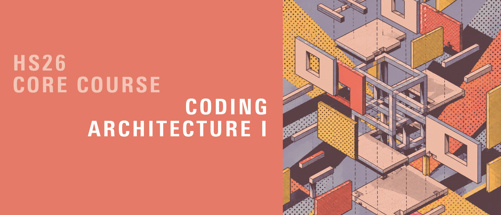

# Coding Architecture I: HS26

Use the [HS26 building-grid conventions](../week-07/building-grid-conventions.md) for face winding, façade frames, and compass orientation.

## Week 09 - Facades and Attractors

## Table of Contents

* [Overview](#overview)
* [Slides](#slides)
* [Tutorial Series](#tutorial-series)
* [Attractor Exercise](#attractor-exercise)

## Overview

This week we’re programming the final components of our building grid. We’ll finish our structure by adding facades, completing the primary architectural elements. Using the VolMesh data structure, we’ll find methods to create these elements dynamically.

We'll also revisit attractor points as a way to introduce a bit of creativity, allowing for design adjustments across facade elements based on the proximity to these points.

>**Learning Goals:** Develop flexible facade classes within the VolMesh framework, exploring how architectural elements interact structurally and spatially.

## Slides

    

        ↑ click to open ↑
    

## Tutorial Series

We’ll complete our building element classes by creating **facades** within the building grid, using the VolMesh data structure. Additionally, we will use **attractors** to add variability to the facade expression, and look at how storey heights could vary.

The following files are useful to follow the lecture content:

- [Building grid: Tutorial Facades](examples/01-building-grid-facade_hs26.gh)

The tutorial uses **North = +Y, East = +X, South = −Y, West = −X**, based on outward face normals, matching a north-up plan with +Z upward and Rhino's default model North. The South-only attractor exercise acts on the −Y façade. Keep this convention when filling in the template. If you place the model on a real site, define geographic North explicitly.

The starter continues A03 with the same fixed-height constructor. Carry over your completed `generate_slabs` method and slab categorization, then add a `Wall` class (`Wall(geometry, halfface, orientation="S")`, as on the slides) and complete `generate_facades`. In the `Grid` component, generate columns, beams, slabs and façades in that order, adding the call `grid.generate_facades(facade_thickness)` after the slabs. All element boxes are accessed through `.geometry`. The façade-attractor branch starts disabled in the student file; enable it after completing its script and referencing an attractor curve. The South-only rotation only works as intended once your walls carry their orientation; with the default `"S"`, every panel is rotated.

The height-variation snippet on the slides is an optional extension: build the VolMesh with a list of per-storey heights (one per storey, `nz` values) instead of a single `zsize`. The default constructor stays fixed-height. If you replace the VolMesh, regenerate columns, beams, slabs, slab categories and façades.

## Attractor Exercise

The goal of this exercise is to implement simple methods to experiment with the building/facade design and learn how to create and use attractors.

Use the files below to do the exercise:

- [Attractors: tiny exercise](examples/attractors_hs26.gh)
- [Attractors: tiny exercise solution](examples/attractors_solution_hs26.gh)

---

