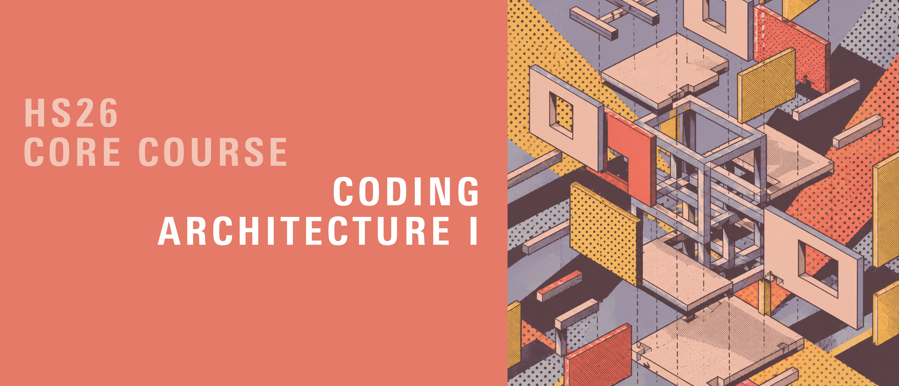
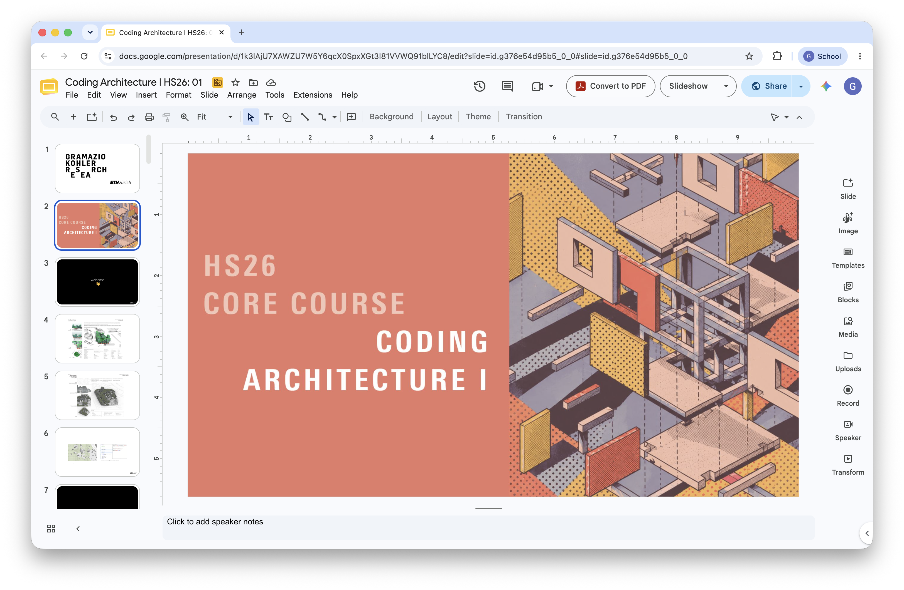
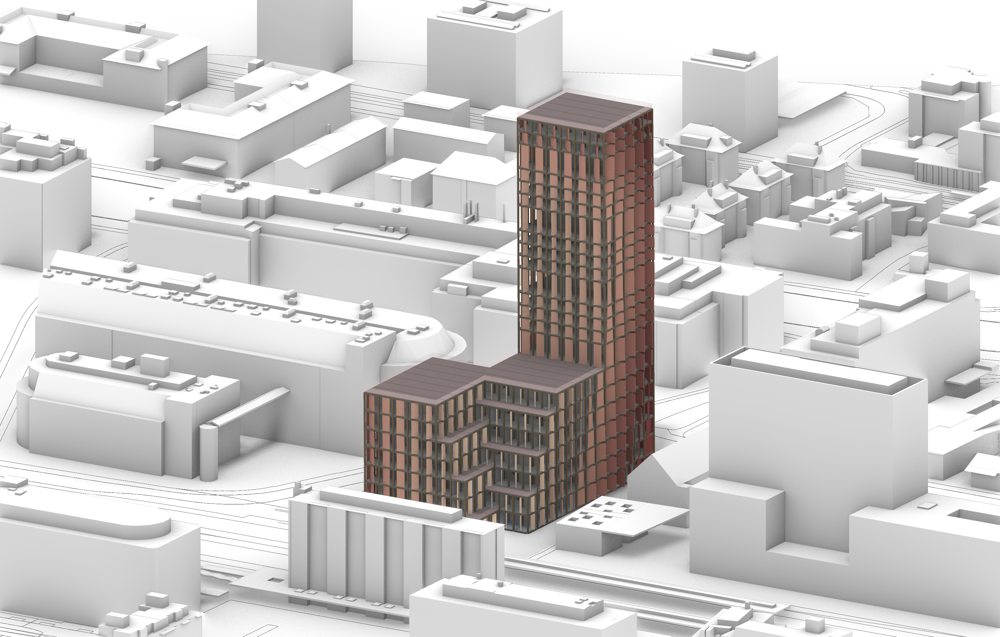
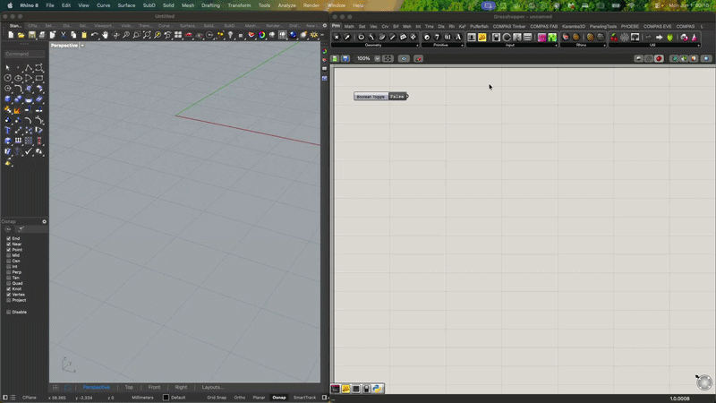

# Coding Architecture I: HS26

## Week 10 - Final Project



## Table of Contents

* [Overview](#overview)
* [Slides](#slides)
* [Personalized Quiz](#personalized-quiz)
* [Final Project](#final-assignment)
* [AI Workflows](#ai-workflows)
  * [Think in systems](#think-in-systems)

## Overview

In Week 10, we will introduce the final project, where you will apply all the concepts learned throughout the course to design a comprehensive building structure.

>**Goal:** integrate all knowledge gained during the assignments into a more complete building structure.

We will also look at **AI workflows**: how an AI agent (Claude Code, Codex, GitHub Copilot, ...) can work directly on your live Rhino and Grasshopper session using LAMCP.

You will also take the third personalized quiz, this time about your A03 submission.

## Slides

[](https://docs.google.com/presentation/d/1AhXTvabg3bVQK9oSsqpmpZyj3vOpxcaVmN0u_l9_GAI/edit?usp=drive_link)

<div style="display: flex; justify-content: center; align-items: center; height: 1vh;">
    <p style="font-size: 75%;">
        ↑ click to open ↑
    </p>
</div>

## Personalized Quiz

This week you will take the third personalized quiz, about the code you submitted for A03: 6 questions in 20 minutes, asking you to explain and reason about your own code. The quiz is graded and counts for 40% of your A03 grade.

## Final Assignment



### Design Project

In this final assignment, you will integrate all the concepts learned throughout the course into a comprehensive building structure. Using Python programming, you will create a building that incorporates architectural components such as slabs, columns, and facade walls, sculpted by a filter class.

Your building will be placed in a real location in the city of Zurich. You can choose one of the following five plot locations for your design project: **Altstetten**, **Hardturm**, **Letzi**, **Heinrich-Areal**, or **Escher Wyss**. Each location has unique characteristics and potential constraints, so consider factors like plot size, shape, and local context when making your choice.

[→ CLICK HERE ← to access the final task description.](../../assignments/A04-final-project/README.md) 

---

## AI Workflows

So far, AI assistants only saw the code in your editor. With **LAMCP**, an AI agent can also *look at and act on* your open Rhino and Grasshopper session: list the components on your canvas, read the data flowing out of them, run Python inside Rhino and take screenshots of the viewport.



### How it works

LAMCP uses the **Model Context Protocol (MCP)**, an open standard that lets AI agents use external tools. Because MCP is a standard, LAMCP is not tied to one product: it works with almost any coding agent, including Claude Code, Codex and GitHub Copilot. LAMCP has two halves:

* The **LAMCP server** (`lamcp`), a small Python program that your agent starts. It tells the agent which tools are available.
* The **LAMCP Bridge**, a Grasshopper component that receives the agent's requests and runs them inside Rhino.

```text
AI agent (Claude Code, Codex, Copilot, ...) ──MCP──▶ lamcp ──http://127.0.0.1:8765──▶ LAMCP Bridge (Grasshopper)
```

### Setup

Setup has two steps: install the bridge in Grasshopper once, then tell your agent how to start the LAMCP server. The second step is the same idea for every agent: register a server named `lamcp` that runs the command `uvx lamcp`.

You need `uv`, which is already installed if you ran the course's VS Code setup script. Otherwise, [install uv](https://docs.astral.sh/uv/getting-started/installation/) and restart VS Code. `uvx` downloads and runs the latest version of `lamcp` the first time it starts; you do not need to install it yourself.

#### 1. Install the bridge in Grasshopper

1. Download `Lamcp_Bridge.ghuser` from the [latest LAMCP release](https://github.com/gramaziokohler/lamcp/releases/latest).
2. In Grasshopper, open *File → Special Folders → Components Folder* and move the file there.
3. Restart Rhino. The `LAMCP Bridge` component appears under the `LAMCP` tab.
4. Drop it on the canvas and connect a `Boolean Toggle` set to `True` to its `enable` input. The `status` output should read `listening on http://127.0.0.1:8765`.

#### 2. Connect your agent

Pick the agent you use. You only need one of them.

**Claude Code** (requires a paid Claude plan)

1. Install the **Claude Code** extension from the VS Code Extensions view (`Ctrl+Shift+X` / `Cmd+Shift+X`) and sign in.
2. In the Claude Code panel, type `/mcp` and add a server named `lamcp` with the command `uvx lamcp`, at **user** scope so it is available in every project.

   If you have also installed the [Claude Code command-line tool](https://code.claude.com/docs/en/setup), you can do the same from the terminal instead:

   ```bash
   claude mcp add lamcp --scope user -- uvx lamcp
   ```

3. Start a new conversation and type `/mcp`: `lamcp` should show as **Connected**.

**Codex** (requires a ChatGPT account)

1. Install the **Codex** extension from the VS Code Extensions view and sign in.
2. Open the gear menu, select **MCP servers → Add server**, enter the name `lamcp`, choose **STDIO** and the command `uvx lamcp`. Save, then select **Restart extension**.

   Alternatively, add it to `~/.codex/config.toml` (shared by the Codex extension and command-line tool):

   ```toml
   [mcp_servers.lamcp]
   command = "uvx"
   args = ["lamcp"]
   ```

**GitHub Copilot** (free for students, [see here](../../getting-started/github-copilot/README.md))

1. Open the Command Palette (`Ctrl+Shift+P` / `Cmd+Shift+P`) and run **MCP: Open User Configuration**.
2. Add the `lamcp` server and save the file:

   ```json
   {
     "servers": {
       "lamcp": {
         "type": "stdio",
         "command": "uvx",
         "args": ["lamcp"]
       }
     }
   }
   ```

3. Open the Chat view, switch the mode to **Agent**, click the tools icon and check that the `lamcp` tools are enabled.

**Any other agent:** look for "MCP servers" in its settings or documentation and register a stdio server that runs `uvx lamcp`.

#### 3. Check the connection

With the bridge enabled in Grasshopper, ask your agent: *"Check that the LAMCP bridge is reachable."* Agents ask for permission before running a tool; read what they want to do before you allow it.

### Think in systems

The most important part of working with an agent is not the setup but **how you talk to it**. Do not ask the agent to *solve the problem* for you. An agent can produce a working building in one go, but what you get is a one-off: a long script that does exactly one thing, that you did not design and that you cannot reuse.

Instead, use the agent as a partner to **think in systems**, the same way we have worked throughout the course:

* **Look for commonalities first.** Before writing any code, discuss your design with the agent: which elements repeat, which follow the same logic with different parameters, which depend on each other? A column, a mullion and a façade fin might all be "a linear element placed on a grid".
* **Find the components.** Turn those commonalities into small, well-defined parts with clear inputs and outputs: a class, a function, a filter, a Grasshopper component. Ask the agent to help you name them and decide what each one is responsible for.
* **Build larger systems from them.** Combine the components into the building, so that changing one part (the grid, the filter, the façade rule) propagates through the whole design.
* **Design for reuse.** A good component works beyond this project: in another plot, another building, next semester. Ask the agent *"where else could this be used, and what would need to change?"*

Compare the two approaches:

| Solving the problem | Thinking in systems |
|---|---|
| *"Write a script that generates my building with slabs, columns and a façade."* | *"These are the elements of my building. Which of them share the same logic? Propose a set of components, with their inputs and outputs, that I could combine to build it."* |
| *"Make the façade panels rotate towards the sun."* | *"I want façade elements that respond to an attractor. How could I make this a component that works with any attractor and any type of panel, not just this one?"* |

Keep the conversation going: question the agent's proposals, ask for alternatives and decide on the structure yourself. The agent writes code quickly; **the system is your design work**, and it is what you can carry into your next projects.

### Things to try

Open your final project file in Grasshopper (with the bridge on the canvas) and try prompts such as:

* *"List the components on my Grasshopper canvas and tell me which ones show errors or warnings."*
* *"How many columns, beams, slabs and façade panels does my building have? Inspect the component outputs."*
* *"Capture the Rhino viewport from the front and check that the slabs line up with the beams."*
* *"Explain what the script in my `Grid` component does, step by step."*
* *"Look at the scripts on my canvas. Which parts repeat the same logic, and how could I turn them into reusable components?"*
* *"If I wanted to use my façade system on a different plot, what in my code would break? Help me make it independent of this plot."*

### Good practices

* **You are responsible for the code you submit.** Use the agent to explore, debug and learn, and make sure you understand every line that ends up in your project. Your final project submission includes a declaration on AI usage: declare how you used these tools.
* **Save first.** The agent can change your canvas and your Rhino document. Save your `.gh` file before asking it to modify anything.
* **Verify the results.** A definition without errors is not necessarily correct: check counts, look at the geometry and test edge cases.
* **Switch the bridge off when you are done.** The bridge runs any Python code it receives, with no password. It only accepts connections from your own computer, but set the toggle to `False` when you are not using it.

---

<p align="middle">

</p>
