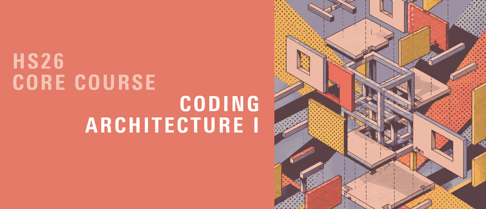
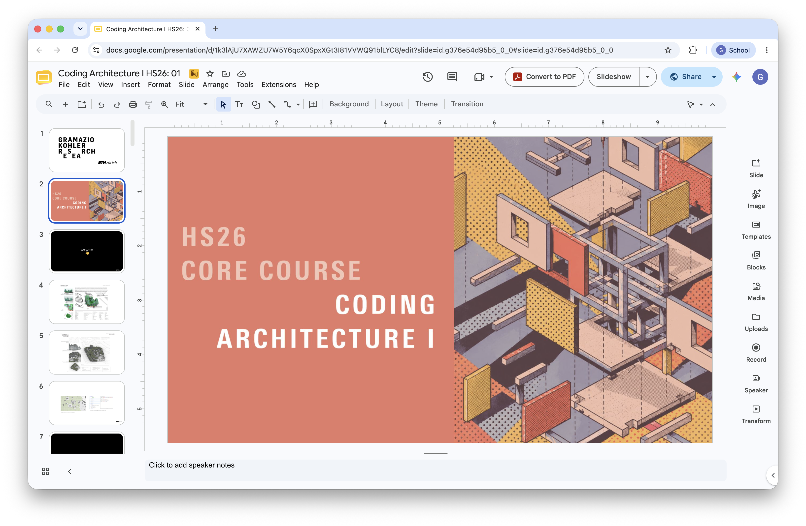

# Coding Architecture I: HS26

## Week 11 - Final Project

## Table of Contents

* [Overview](#overview)
* [Slides](#slides)
* [Administration](#administration)

## Overview

Today's lecture covers the final project deadlines and presentation, a review of [Assignment 03](../../assignments/A03-building-grid/README.md), and a tutored session where you can work on your [final project](../../assignments/A04-final-project/README.md) with the help of the teaching team.

## Slides

    

        ↑ click to open ↑
    

## Administration

### Submission Final Project

>**Deadline:** Monday, 30th of November at 23:59

Upload your final project via Polygrade. See the [final project deliverables](../../assignments/A04-final-project/README.md#deliverables).

### Presentation

>**Date:** Thursday, 3rd of December at 15:45

>**Location:** HCI Room J7

For the final presentation, we will select approximately 10 projects that demonstrate interesting approaches. The selected authors will be asked to present their work in class.

### Grades

You will receive your grades for the final project in the week following the presentations.

---

